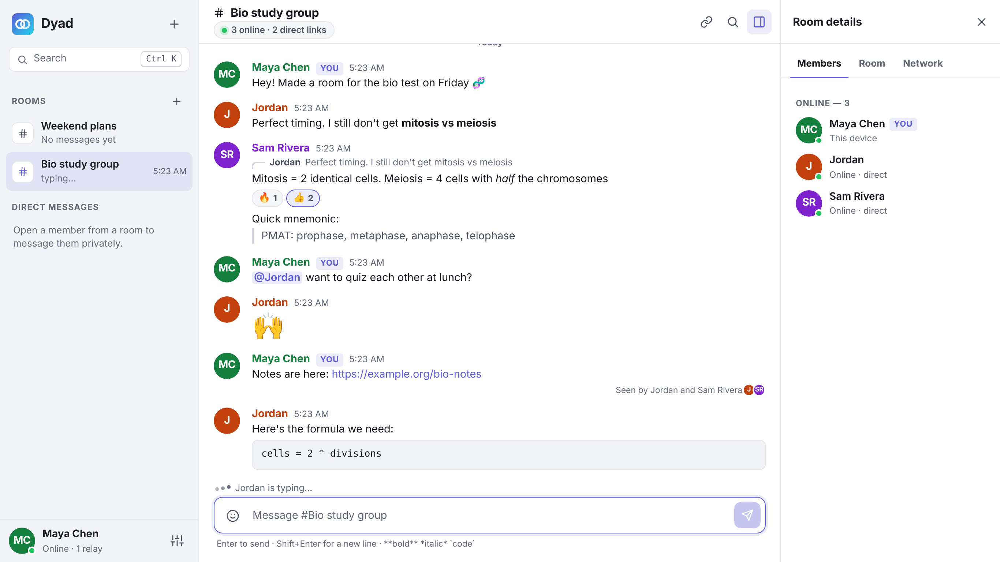
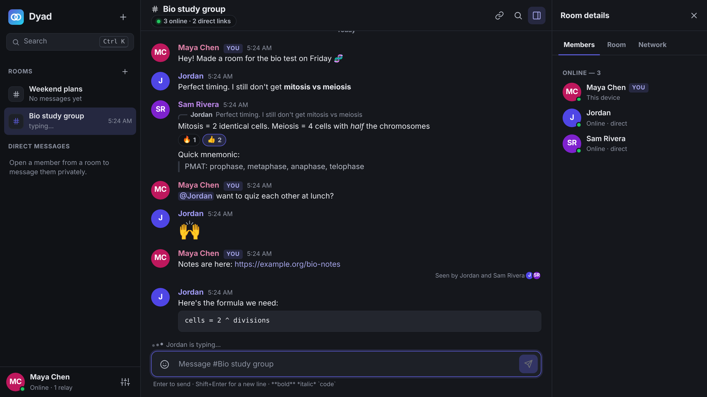
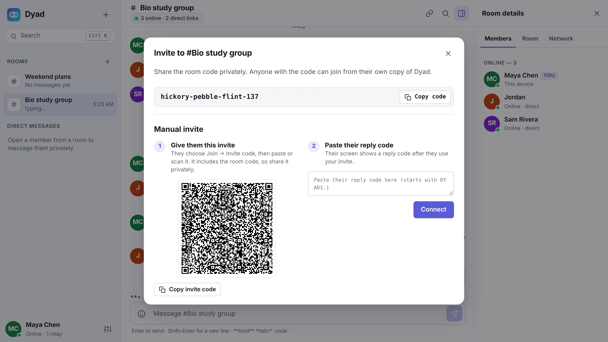

# Dyad

**Private group chat in a single HTML file.** No accounts, no tracking, and no server in the middle of your messages.
Open `Dyad.html` in Chrome, pick a name, share a room code, and chat. Messages travel directly between devices and are end-to-end encrypted.



> Not related to the "Dyad" AI app builder. This is a peer-to-peer chat app.

## Get started

1. Download `Dyad.html` from the [latest release](https://github.com/Eigengrau-i5d/Dyad/releases/latest) (or from this repository).
2. Open it in Chrome, Edge or another Chromium browser (Chromebooks work). Double-click the file, or drag it into a browser tab.
3. Choose a display name, then **Create a room** and send the room code to your friends. They open their own copy of `Dyad.html` and **Join a room** with the code.

That's all. There is nothing to install and nothing to sign up for.

## Features

- **Group rooms** with a room code and an optional password
- **Direct messages** between two people, with their own key
- **Replies, reactions, editing, deleting**, `**bold**`, `*italic*`, `` `code` ``, quotes, links and **@mentions**
- **Typing indicators, read receipts and presence** (all optional)
- **History sync**: people who join later receive recent messages from whoever is online
- **Search** across all rooms (Ctrl+K) and in a room (Ctrl+F)
- **History lock**: encrypt everything on the device with a passphrase
- **Encrypted backups** to move to a new device
- **Manual invites** with a code or QR code, for networks that block relays
- **Light and dark themes**, accent colours, keyboard shortcuts, and layouts for phone, tablet and desktop

<p align="center"> </p>

## How it works

| Step | What happens |
|---|---|
| Find each other | Devices post an **encrypted hello** on free public relays (WebTorrent trackers, Nostr relays, MQTT brokers) under a topic derived from the room code with slow PBKDF2. The relays see only random-looking blobs. |
| Connect | Devices swap WebRTC connection details through those relays, then open a **direct, encrypted** data channel (DTLS). |
| Mesh | Once any two members are connected, they negotiate further connections **through each other**. They also forward messages, so people who cannot reach each other directly still chat. |
| Trust | Every message is **signed** with the author's ECDSA key, so nobody can fake or change another person's messages. Compare **safety codes** to verify a friend in person. |
| Store | History lives **only on your device** (IndexedDB). Turn on the history lock to encrypt it with your passphrase. |

There is no Dyad server. If every relay is blocked, use **Invite → Manual invite** to connect devices on the same Wi-Fi with a code or QR code.

### Security details

- Room key: PBKDF2-SHA-256 (310,000 rounds) of room code + password, then AES-256-GCM.
- Relay topic: a separate PBKDF2 derivation of the room code, so relay operators cannot cheaply guess codes.
- Identity: ECDSA P-256 (signing) and ECDH P-256 (direct messages), created on your device.
- History lock: PBKDF2-SHA-256 (600,000 rounds) wraps a random AES-256-GCM data key.
- Strict Content Security Policy: no remote scripts, styles, fonts or images. The only network connections are the relays you configure and, optionally, STUN for NAT discovery.
- Everything you type is rendered as text. Links open only for `http`/`https`.

### Limits to know

- **Someone has to be online.** Messages are delivered when members are connected. History syncs when anyone who has it comes online.
- **School and work networks** may block relays, or block direct links between devices. Try a manual invite, a phone hotspot, or a TURN server you trust (Settings → Network).
- **Managed Chromebooks** may block opening local files. Ask your administrator, or use a hosted copy.
- **Deleting a message** removes it from every device that is running Dyad, but a modified app could keep a copy.
- Follow your school's or employer's device rules. Dyad does not try to bypass filters or monitoring.

## Verify your download

Each release includes `SHA256SUMS.txt`. On a Chromebook or Linux:

```bash
sha256sum Dyad.html
```

Compare the result with the checksum in the release notes.

## Licence

MIT. See [LICENSE](LICENSE). `Dyad.html` bundles no third-party code. It is unminified, so you can read exactly what it does.
